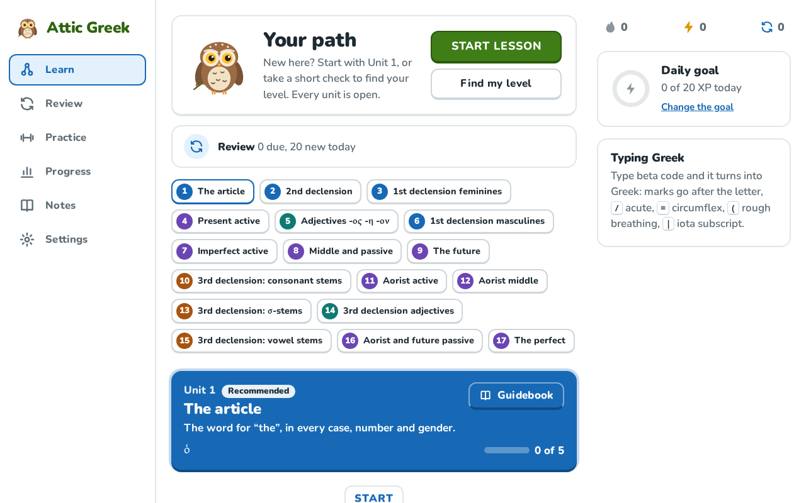
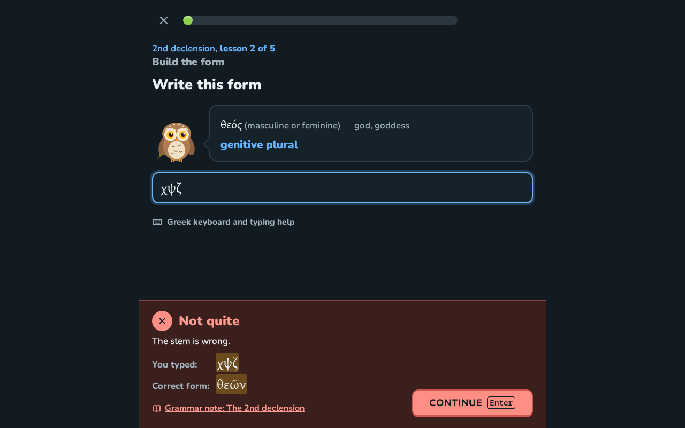
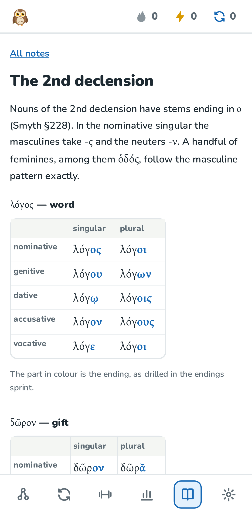

# Attic Greek Morphology

**This Game was entirely vibe coded for my sister.**

[](https://github.com/soliveira3/attic-greek-game/actions/workflows/ci.yml)
[](LICENSE)
[](data/LICENSE)

A free, static web game for drilling the forms of Attic Greek nouns, adjectives and verbs until
they are automatic. It runs entirely in the browser: no account, no server, progress stays in
your browser (and can be exported).

**Play it: <https://soliveira3.github.io/attic-greek-game/>**

<p>
  
  
</p>

## What it does

- **Parse it** — identify a form: case, number, gender, or tense, voice, mood, person, number.
- **Fill the table** — complete a paradigm, or one tense and voice of a verb.
- **Make it** — type the form the features ask for.
- **Endings sprint** — sixty seconds of endings for one declension class or tense and voice.
- **Review** — a daily spaced-repetition queue (FSRS) in Make it format.
- **Progress** — day streak, reviews due, accuracy heat maps laid out as paradigm tables, export
  and import of progress.
- **Grammar notes** — short original notes citing Smyth's *Greek Grammar*, linked from every
  wrong answer.

Type with beta code (`lu/w` gives λύω), a Greek keyboard, or the on-screen keyboard. Answers are
checked against every valid form; by default accents are pointed out but do not count (strict
and lenient modes are in Settings). The scope (parts of speech, classes, tenses, voices, dual) is
set in Settings. See [docs/SPEC.md](docs/SPEC.md) for the full specification.

**Coverage (v1):** the article; 1st, 2nd and 3rd declension nouns (consonant, σ-, ι-, υ- and
ευ-stems); adjectives of two and three endings; thematic ω-verbs in the present, imperfect,
future, aorist (1st and 2nd) and perfect, active, middle and passive, indicative and infinitive.
282 words from the DCC Greek Core list.

<p align="center">
  
</p>

## Where the forms come from

No form is typed by hand. Every form comes from English Wiktionary (via the kaikki.org
extraction), built by the Python pipeline in `pipeline/`, cross-checked against Morpheus, and
filtered to Attic. The model paradigms in `data/golden/` were compared with Smyth and verified.
Known gaps and exclusions are listed in `data/paradigms/REPORT.md` and `data/exclude.txt`.

**Found a form that looks wrong?** Please
[report it](https://github.com/soliveira3/attic-greek-game/issues/new?template=wrong-form.yml)
with your source. A Greek teacher's review checklist is in
[docs/REVIEW_GUIDE.md](docs/REVIEW_GUIDE.md).

## Running it

Requirements: Node 22, Python 3.11+ (3.14 used).

```bash
cd app
npm ci
npm run dev          # http://localhost:5173
npm run build        # static site in app/dist/
```

Requirements are pinned (`.nvmrc`, `app/package-lock.json`, `pipeline/requirements.txt`).

Tests and lint (all of them, as CI runs them):

```bash
python -m venv pipeline/.venv && pipeline/.venv/bin/pip install -r pipeline/requirements.txt
(cd app && npx playwright install chromium)
bash scripts/check.sh
```

`scripts/check.sh` runs ruff and the pipeline tests (pytest); oxlint, the app's unit and
component tests with coverage (Vitest) and the type check; and the Playwright browser tests:
a round of every mode, accessibility (axe) on every page in both themes, and a clean console
under the Content-Security-Policy (`SKIP_E2E=1` skips the browser tests). `npm run screenshots`
refreshes the images in `docs/images/`. Rebuilding the data from the sources is described in
[docs/DATA_SOURCES.md](docs/DATA_SOURCES.md).

## Deployment

`.github/workflows/ci.yml` runs the checks on every push and deploys `app/dist` to GitHub Pages
from `main`. The site uses hash routes and relative asset paths, so it works from any path.

## Data sources and licenses

| Source | Used for | License |
|---|---|---|
| [English Wiktionary](https://en.wiktionary.org/), extracted by [kaikki.org](https://kaikki.org/) (wiktextract) | All inflected forms | CC BY-SA 4.0. The derived data in `data/paradigms/` and `data/golden/` is CC BY-SA 4.0 too. |
| [DCC Greek Core Vocabulary](https://dcc.dickinson.edu/greek-core-list) (C. Francese, Dickinson College Commentaries, 2014) | Choice and order of words; glosses | CC BY-SA |
| Morpheus (Perseus Project), via libmorpheus | Cross-checking only; not shipped | AGPL-3.0-or-later (libmorpheus) |
| Smyth, *Greek Grammar* (1920), via Perseus | Verifying the model paradigms; section numbers cited in the notes | Public domain |
| [Gentium Plus](https://software.sil.org/gentium/) (SIL), via @fontsource | Greek font, bundled | SIL Open Font License 1.1 |
| [ts-fsrs](https://github.com/open-spaced-repetition/ts-fsrs) | Spaced-repetition scheduling | MIT |

Details, versions and checksums: [docs/DATA_SOURCES.md](docs/DATA_SOURCES.md).

**License.** The code and the grammar notes are MIT ([LICENSE](LICENSE)). The paradigm data is
CC BY-SA 4.0 ([data/LICENSE](data/LICENSE)).

## Project documents

- [CONTRIBUTING.md](CONTRIBUTING.md) — setup, the data rules, how to report a wrong form
- [docs/ARCHITECTURE.md](docs/ARCHITECTURE.md) — how the pipeline and the app fit together; performance
- [docs/SPEC.md](docs/SPEC.md) — v1 specification; [CHANGELOG.md](CHANGELOG.md) — releases
- [docs/REVIEW_GUIDE.md](docs/REVIEW_GUIDE.md) — checklists for a Greek teacher and for play-testers
- [SECURITY.md](SECURITY.md) — reporting a vulnerability
- [docs/PLAN.md](docs/PLAN.md) — roadmap; [docs/PROGRESS.md](docs/PROGRESS.md) — status
- [CLAUDE.md](CLAUDE.md) — rules for working on the project (it was built with Claude Code)
